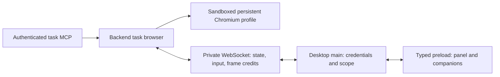

# Persistent task browser and streaming

## Decision

The remote browser belongs to the backend task. A desktop window is a detachable
presentation, not the owner of Chromium, its network access or an agent's driver.
Use one authenticated, full-duplex WebSocket per task viewer over the existing
private SSH tunnel. Keep the renderer's named preload methods and restrictive CSP.
The browser's private CDP pipe is never an application API.

This change implements that lifetime boundary and the persistent channel. It does
not claim that JPEG streaming equals a native browser's video, audio or operating
system integration, or that a transport change alone proves lower WAN latency.

## Owners and lifetimes

| Owner | Owns | Ends when |
| --- | --- | --- |
| Runtime service | Bounded task allocation, lifecycle reconciliation, persistence | Backend shutdown |
| Task | Profile, tabs, network grants, agent driver generations | Task leaves ready/archives, incarnation changes or backend stops |
| Viewer | Rotating capability token, layout ordering, private channel | Disconnect, missing heartbeat or replacement |
| Presentation | Visibility, viewport, one outstanding frame receipt | Hidden, closed or viewer disconnected |
| Tab | Live document, navigation, CDP, frame producer | Explicit close, crash or task destruction |

A new MCP caller can prepare the runtime browser when no desktop browser mailbox
or runtime exists. Its authenticated task determines the incarnation/profile;
agents cannot supply filesystem/profile IDs. Existing desktop routing and explicit
`desktopId` selection remain supported. Ambiguous targets require a selection.
Agent-created tabs belong to their creating session. User tabs still require
explicit handoff. Observation remains withheld; this change does not grant arbitrary
JavaScript, page text, screenshots, raw CDP or private-field access.

Hiding or disconnecting a viewer pauses image production and rejects human input.
It preserves live pages, their network connections and current agent ownership.
Agent click/scroll readiness checks the live document, independently of display
visibility. Actual human input, takeover, navigation and engine failure continue
to enforce driver/document generations. Reattachment itself does not take over an
agent's tab. No interrupted input or agent command is replayed.

A remote daemon survives a desktop transport disconnect already; stopping its
browser on a ten-second viewer lease defeated that lifetime. The task now remains
alive without the viewer. The service periodically checks only its at-most-four
retained task records, closes browsers when tasks cease to be ready, and drains
that work during shutdown. A full pool rejects new allocation instead of silently
evicting live tabs. Empty, unviewed owners may be reclaimed. This hard limit should
become configurable with explicit CPU/memory admission policy before larger fleets.

## Protocol version 1

`TaskBrowserState.streamVersion: 1` advertises the optional channel. The desktop
still obtains initial state and a viewer capability through existing private HTTP
routes. It then opens `/api/desktop-browser/runtime/tasks/:taskId/stream` with
main-owned transport authentication and the viewer token in headers. Tokens never
appear in URLs, renderer state, browser page scripts or logs.

The backend rejects TCP, Origin/Fetch headers, invalid/expired capabilities and
inactive tasks before upgrading. The edge proxy permits only this exact additional
upgrade route. It does not enable WebSocket upgrades for all `/api` routes. JSON
commands pass through the existing runtime validators and handoff authorization.
The private transport remains unavailable to the legacy unauthenticated TCP API.

| Message | Behavior |
| --- | --- |
| `command` | Existing tab/navigation/handoff/tool intent; request ID and receipt |
| `input` | Existing ordered bounded input batch; generation checked per event |
| `layout` | Panel or companion viewport, visibility and independent sequence |
| `frame` | One frame credit with tab ID and last displayed sequence |
| `cancel` | Cancels that pending read; never replays a mutation |
| `ping` | Renews lease and checks task eligibility/server suggestions |
| State event | Coalesced revision changes pushed by the task, including MCP changes |
| Binary reply | Four-byte metadata length, bounded JSON header, raw JPEG bytes |

IDs increase monotonically per connection; duplicate IDs close the channel rather
than executing an action twice. At most 32 requests and one frame waiter per tab
are accepted. The main adapter also bounds requests and outgoing buffered bytes.
Binary frame replies are capped at 3 MB; JSON envelopes at 512 KiB (to accommodate
bounded Unicode input). Compression is disabled: JPEG is already compressed and
compressing control traffic would add CPU and memory overhead.

A presentation requests its next frame only after the renderer acknowledges
successful decode/display of the current frame. Chromium retains one latest image,
replacing obsolete images rather than building a queue. Existing acknowledgement
latency adapts JPEG quality and resolution; hidden/slow displays stop encoding.
A layout must finish before its first frame credit so the frame cannot race an
unpublished viewport. One presentation cannot acknowledge/cancel another's frame.

There is no HTTP frame, input or layout loop on upgraded hosts, and task metadata
changes are events. Three-second channel heartbeats and presentation freshness
remain intentional: they release input authority and resources after a dead client.
An unchanged page waits for compositor changes rather than taking periodic
screenshots. A bounded screenshot seeds a newly attached or resized static page.
The old frame route and state polling remain a compatibility fallback only when
the host omits `streamVersion`; an advertised but broken channel fails visibly.

Navigation/frame waits do not serialize the entire channel: takeover and input
can still arrive while another request waits. Domain generation checks remain the
arbiter of conflicting actions. On disconnect all reads are aborted, listeners
removed and unconfirmed operations rejected with an unknown-outcome message. The
backend scope owns the socket via `BackendClient.execute` with no request deadline;
scope invalidation/window disposal still aborts it. Reconnect reconciles durable
state before accepting further input.

## Persistence guarantees

* Closing the desktop or losing SSH leaves the **remote** backend task browser
  running, including in-memory documents, while its daemon and task remain alive.
* Explicit backend shutdown closes Chromium. Its task-specific profile retains
  cookies, localStorage, IndexedDB, service workers and cache storage. Safe tab
  locations/order/provenance are saved separately and restored lazily.
* Restart does not preserve JavaScript heaps, pending requests, form drafts, scroll,
  query/hash locations or driver grants. Restored tabs require explicit handoff.
* Local Electron browser guests still have desktop-process lifetimes. A machine
  power-off, daemon stop or server reboot is a profile restore, not a live resume.
* No profile sharing between tasks/incarnations or local/remote placements occurs.

## Feature architecture and next slices

The transport is extensible; the following remain planned rather than advertised
as working capabilities. Each slice needs contracts, runtime validation, failure
and cleanup tests, and real UI/native verification before its capability is enabled.

| Slice | Domain ownership and constraints |
| --- | --- |
| Popups/OAuth | Adopt validated opener-created pages as bounded task tabs; preserve opener relationship; apply network policy before navigation; background popups must not steal human selection |
| Page dialogs | Tab-owned dialog ID and document generation; explicit accept/dismiss/prompt; reply must bypass any navigation queue that it unblocks; safe unattended policy when no viewer exists |
| Uploads | Main-owned native picker; bounded authenticated chunks/backpressure to task-owned temporary file; cancellation/quota/expiry; no arbitrary remote paths or renderer file reads |
| Downloads | Task-owned temporary artifact and progress events; explicit main save operation; bounded chunk stream separate from interactive frames; resume by artifact offset, not replaying a download click |
| Multiple viewers | Separate viewer identities and frame credit/quality state; one explicit human controller lease; spectator viewports cannot resize the authoritative page; no shared global ACK |
| Cursor/touch/drag | Narrow typed pointer/cursor state and touch gestures; local cursor rendering, coalesced motion, preserved button/key boundaries; OS drag/drop needs an explicit file policy |
| Accessibility/find | Named, permissioned AX/find operations with bounded results; never mirror untrusted DOM into application UI or silently change agent observation policy |
| Video/audio | Negotiated media capability and encoder owner; separate media delivery from reliable input/control; explicit audio ownership/mute and echo behavior |
| Web/mobile | Authenticated gateway with scoped expiring viewer credentials, Origin checks and TLS; reuse domain/presentation protocol without exposing the Unix socket or CDP |

For high-motion video and audio, evaluate WebRTC with a real encoder rather than
sending JPEGs faster. Its congestion control and media channels are useful, but
CDP screencast is compressed still images: it does not supply an encoded video/
audio track. WebRTC therefore requires capture/encoding, signaling and a network
policy (ICE/TURN); it cannot simply replace this socket. The existing SSH path has
no direct browser-to-server UDP and keeps all page/network credentials in main.
A future media adapter should negotiate independently and retain this control
protocol. WebCodecs over a reliable socket is another option, with TCP
head-of-line blocking and codec availability measured explicitly.

Before choosing another codec, collect page-free counters: encode/decode/display
latency, ACK delay, bytes/second, dropped/replaced frames, socket buffered bytes,
input-to-visible-update latency, CPU and memory per tab. Compare static pages,
scrolling, animation and video at several RTT/bandwidth/loss levels, including
concurrent companions and a disconnected viewer. Report p50/p95 and quality; a
loopback smoke test cannot establish WAN smoothness or native-browser parity.

## Research

* [T3 Code stream source](https://github.com/pingdotgg/t3code/blob/main/apps/server/src/preview/ServerBrowserStream.ts)
  demonstrates persistent streaming, bounded replacement frames and paced receipts.
  This implementation uses Elevenex's existing transport/domain boundaries rather
  than adopting T3's Effect runtime or its deployment/security assumptions.
* [Chrome DevTools Page protocol](https://chromedevtools.github.io/devtools-protocol/tot/Page/)
  defines screencast events, acknowledgments and still capture. APIs used here are
  also checked against the locked Playwright/CDP types.
* [Playwright persistent context](https://playwright.dev/docs/api/class-browsertype#browser-type-launch-persistent-context)
  documents browser-profile storage and context ownership.
* [Browserless session management](https://docs.browserless.io/baas/session-management)
  distinguishes reconnecting to a live browser from persistent profile restoration.
  That distinction is essential to the guarantees above; no external browser
  service/dependency is introduced.

## Verification

Regression suites cover the private WebSocket/TCP boundary, runtime validation,
pushed state, request-ID replay rejection, binary frames, cancellation, unknown
mutation outcomes, task capacity and viewer-free driver retention. A real
sandboxed Chromium fixture starts through the MCP service without a viewer,
reattaches/detaches a viewer and clicks a live page over the retained task network.
The native Electron machine-browser smoke covers both persistent-channel and
legacy-HTTP hosts with shared panel/companion ownership. Profile restart storage
has a separate real-Chromium regression. External SSH/WAN benchmarks, packaged-app
launches and additional feature slices are separate verification scopes.

Validated on macOS during this change: `pnpm desktop:lint`, `pnpm desktop:test`
(including 649 renderer tests), `pnpm desktop:build`, `pnpm backend:build`, backend
contract compilation, 36 browser backend regressions and the native Electron
smoke. New transport source/tests also pass the backend's typed ESLint rules.
The native smoke uses a fixture backend; the separate integration test uses real
sandboxed Chromium and a private Unix WebSocket. No packaged-app or external
SSH/WAN performance claim is made. No renderer layout or styling changed.
