# Persistent task browser and streaming

## Decision

The remote browser belongs to the backend task. A desktop window is a detachable
presentation, not the owner of Chromium, its network access or an agent's driver.
Use one authenticated, full-duplex WebSocket per task viewer over the existing
private SSH tunnel. Keep the renderer's named preload methods and restrictive CSP.
The browser's private CDP pipe is never an application API.

Presentations negotiate H.264 video, with JPEG for older hosts or a failed codec.
Control and task ownership stay independent of the media producer. The current
SSH connection is reliable TCP: video compression reduces bytes but cannot remove
TCP head-of-line blocking or establish native-browser parity on a WAN.

```mermaid
flowchart LR
  Agent[Authenticated task MCP] --> Task[Backend task browser]
  Task --> Chromium[Sandboxed persistent Chromium profile]
  Chromium --> Capture[Bounded compositor JPEG source]
  Capture --> Encoder[Presentation-owned FFmpeg: H.264]
  Encoder --> Stream[Private WebSocket: video window and reliable control]
  Stream <--> Main[Desktop main: credentials and scope]
  Main <--> Renderer[Typed preload: panel and companions]
  Renderer --> Decode[WebCodecs decoder and canvas]
```

## Video decision and implementation

The implemented path is **H.264 Annex B access units → private WebSocket over
SSH → typed main/preload delivery → WebCodecs**. Use independent, bounded
producers/encoders/receivers/decoders rather than a recording API or a video file.
There is no MP4/WebM fragment accumulation, playback timeline, MSE buffer or frame
polling on this path. Decode requests use `optimizeForLatency`; each returned
`VideoFrame` is drawn and closed. Actual display receipts release capacity.

| Boundary | Implementation and budget |
| --- | --- |
| Capture | Existing private CDP compositor events; one latest JPEG, quality 95, adaptive resolution bounded to 1920×1440 and the H.264 level ceiling; at most 60 updates/second; static seeding only when necessary |
| Encoder | One persistent FFmpeg subprocess per visible presentation; baseline H.264, one reference and no B frames; GPU-specific low-latency profiles with libx264 `ultrafast`/`zerolatency` fallback; adaptive FPS, bitrate and thread budget |
| Local encoder I/O | Length-delimited multipart JPEG input prevents waiting for a subsequent image; encoded packet sizes use FFmpeg's private `stats_mux_pre` pipe, so output never waits for another Annex B delimiter or a container fragment |
| Delivery | Three packets for older peers; newer peers negotiate up to eight, paced by recent display latency; 3 MB per packet; pause capture/encoding above 512 KiB socket buffering or 3 MB in flight; five-second stalled-viewer deadline |
| Receiver | Scoped subscription ID, strict contiguous sequence, bounded queue, cumulative display receipts; no replay after transport failure |
| Decoder | Fresh epoch begins with a keyframe; validate baseline SPS allocation bounds before decoding; one pending decode/output; two-second output deadline; close decoder and frames on replacement/destruction |

Resizing or changing pixel density replaces the encoder and sends a new keyframe
epoch while preserving the presentation's delivery sequence. Physical resolution
honors device pixel ratio within the capture cap. The reliable control lane is
multiplexed on the socket; it shares TCP congestion, so this is not a separate
network priority channel. The negotiated delivery window avoids the former one-frame-per-RTT limit. The
frame-rate policy also accounts for the window/RTT ceiling; no configuration
guarantees 60 FPS on an arbitrary device or network.

`videoStream: 'h264'` is additive. Older clients continue using `frame`, and older
hosts retain their existing socket/HTTP behavior. A `video` start/ack/stop command
uses a fresh subscription UUID. Binary video events include tab/subscription,
sequence, CSS dimensions, decoder epoch, key/delta flag and microsecond timestamp.
Hosts advertising `videoWindow: 8` also support one-way ACK/stop receipts. Encoder
start remains a request/response operation. This avoids accumulating per-frame
RPC timers and exhausting the control-request budget with multiple high-RTT views.
Older hosts receive the original receipt shape and responses.
An encoder failure rotates to another probed GPU or software target with a new
keyframe epoch; only exhausted candidates end the subscription and select JPEG. A decoder
failure sends an optional `decoded: false` frame receipt, replacing only that
presentation with JPEG and a fresh display identity. Ordinary five-argument frame
receipts remain compatible. No failed media request retries a browser mutation.

`ffmpeg-static@5.3.0` is the approved, exact-pinned managed runtime (Node >=16;
no Angular peers). Its postinstall downloads the target platform's executable.
Backend bundles keep the package external; local and remote runtime assembly
include its binary, README and license. Remote assembly permits its download
script even when native Node addons cannot be built on the staging host. There
is no renderer-controlled executable path. Compatible host FFmpeg binaries are
also queried and probed to enable hardware codecs omitted from the managed
build. The
package and redistributed binaries have their own GPL license/source obligations;
retain the upstream notices and source references with release artifacts.

### Hardware selection and resource adaptation

| Host | Automatically probed hardware adapters |
| --- | --- |
| macOS | VideoToolbox (OS-managed encoder device) |
| Windows | NVIDIA NVENC, Intel QSV, AMD AMF, hardware Media Foundation |
| Linux | NVENC, QSV and VA-API render nodes, V4L2 M2M where available |
| Any host with a compatible FFmpeg | Software libx264 fallback |

The selected FFmpeg must actually include the encoder and have access to a working
driver/device. Discovery checks the managed binary, an optional administrator
override and compatible absolute PATH entries (at most three distinct binaries).
Each `-encoders` query is bounded; compiled-in names alone grant no capability.
Selection coalesces a page-free synthetic JPEG encode, requires immediate IDR and
baseline SPS output, then decodes that access unit to a fixed 16×16 RGB result.
No real page enters probes or capability caches. FFREPORT file output is stripped.
Positive results cache for five minutes, failures for thirty seconds; session
failures are excluded for that presentation. New presentations can retry after
cooldown without interrupting working streams to benchmark a recovering driver.
Bounded multi-device enumeration and active-device counts prefer less occupied
hardware; failed hardware can fall through to another adapter or software.

The module boundaries are explicit:

* `runtime-video-profiles`: fixed, validated argv and upload formats per encoder.
* `runtime-video-catalog`: executable/device discovery, coalesced probes and cooldowns.
* `runtime-video-resources`: CPU affinity/quota, available memory and sampled CPU load.
* `runtime-video-host`: application-owned catalog, device occupancy, encoder lifetime
  and FIFO work admission shared across tasks/windows.
* `runtime-video-quality`: presentation feedback, resolution/FPS/bitrate selection,
  macroblock/level limits and recovery hysteresis.
* `runtime-video`: stream ownership, keyframe epochs, delivery window and cancellation.

Software begins conservatively (at most 1280×720/30 FPS); hardware can reach the
configured 60 FPS/resolution ceiling. Concurrent views share a pixel-work budget.
Low CPU quota, high load, low memory, slow encoding or growing display latency
reduce work. Resolution reduction reaches the CDP producer as well as FFmpeg,
reducing intermediate JPEG costs. The logical browser viewport and input coordinate
generation remain unchanged. Recovery waits before increasing resolution; actual
viewport changes immediately replace the encoder without retaining the old aspect.
Recent RTT is distinguished from excess display queuing, and the baseline ages
so a route change is not treated as permanent congestion.

The host admits at most one queued encoding operation per presentation, up to 48
presentations, with one to four concurrent operations based on available cores.
CPU affinity is supplemented with cgroup v1/v2 CPU and memory limits where mounted.
Sampling happens on demand at most once a second, without a background timer.
These are conservative scheduling heuristics, not hard OS CPU/RSS quotas or a
promise of optimal performance on every driver. Capture/copies still cost CPU
even with hardware encoding. No app changes device permissions or installs drivers.

Advanced host-administrator overrides are optional; auto is the normal mode:

| Environment variable | Accepted value/default |
| --- | --- |
| `ELEVENEX_BROWSER_VIDEO_ENCODER` | `auto` (default), `software`, `videotoolbox`, `nvenc`, `qsv`, `amf`, `vaapi`, `mediafoundation`, `v4l2` |
| `ELEVENEX_BROWSER_FFMPEG` | Absolute executable path; probed, with managed fallback |
| `ELEVENEX_BROWSER_VIDEO_DEVICE` | GPU index 0–9 for NVENC/Windows QSV, or `/dev/dri/renderD…` for Linux QSV/VA-API |
| `ELEVENEX_BROWSER_VIDEO_MAX_FPS` | 5–60, default 60 |
| `ELEVENEX_BROWSER_VIDEO_MAX_WIDTH` | 640–1920, default 1920 |
| `ELEVENEX_BROWSER_VIDEO_MAX_HEIGHT` | 360–1440, default 1440; level constraints can reduce it further |
| `ELEVENEX_BROWSER_VIDEO_MAX_BITRATE` | 250,000–16,000,000 bits/s, default 8,000,000 |
| `ELEVENEX_BROWSER_VIDEO_CPU_THREADS` | 1–4, default up to 2; further reduced by the shared budget |

Set these on the machine running the browser backend, not on its remote viewer.
The local desktop supervisor forwards only these named video settings; endpoint,
data-root and Node/Electron injection overrides remain stripped. Remote launchers
do not forward the viewer's hardware preferences to another machine. Configure
the remote daemon environment instead. Explicit encoder choices retain software
fallback; `software` disables hardware probing. The selected executable must support
FFmpeg's packet-statistics pipe (normally FFmpeg 6+). No dependency upgrade or
system package installation occurs during a viewer connection.

### Remaining capture and network boundaries

CDP supplies compressed still images, so this implementation still incurs JPEG
capture/decode before video encoding. It substantially reduces network traffic
for repeated content, but is **not a zero-copy capture pipeline**. The next real
CPU improvement is a native raw/compositor capture producer feeding the same
encoder/delivery boundary, with explicit per-platform packaging and sandbox tests.
Do not inject a capture script/bridge into arbitrary sites, weaken the task network
policy, or silently adopt recording APIs that buffer output to obtain that change.
Hardware adapters run only after a bounded real encode/decode probe. Actual
NVIDIA/Intel/AMD/ARM device and Windows/Linux runtime validation require those
hosts; macOS checks do not establish successful operation on other GPUs.

WebRTC is the next transport only when an authenticated direct UDP or TURN path
is provided. Keep signaling on this reliable control channel, define ICE/TURN
credential ownership and egress policy, and reuse the same task/viewer contract.
Putting WebRTC inside the same TCP SSH tunnel preserves its blocking behavior.
WebTransport also requires a new QUIC/UDP listener and does not solve the current
SSH deployment constraint. Neither transport is advertised as implemented.

## Owners and lifetimes

| Owner | Owns | Ends when |
| --- | --- | --- |
| Runtime service | Bounded task allocation, lifecycle reconciliation, persistence | Backend shutdown |
| Task | Profile, tabs, network grants, agent driver generations | Task leaves ready/archives, incarnation changes or backend stops |
| Viewer | Rotating capability token, layout ordering, private channel | Disconnect, missing heartbeat or replacement |
| Presentation | Visibility, viewport, one outstanding frame receipt | Hidden, closed or viewer disconnected |
| Tab | Live document, navigation, CDP, frame producer | Explicit close, crash or task destruction |

A new MCP caller can prepare the runtime browser when no desktop browser mailbox
or runtime exists. Its authenticated task determines the incarnation/profile;
agents cannot supply filesystem/profile IDs. Existing desktop routing and explicit
`desktopId` selection remain supported. Ambiguous targets require a selection.
Agent-created tabs belong to their creating session. User tabs still require
explicit handoff. Observation remains withheld; this change does not grant arbitrary
JavaScript, page text, screenshots, raw CDP or private-field access.

Hiding or disconnecting a viewer pauses image production and rejects human input.
It preserves live pages, their network connections and current agent ownership.
Agent click/scroll readiness checks the live document, independently of display
visibility. Actual human input, takeover, navigation and engine failure continue
to enforce driver/document generations. Reattachment itself does not take over an
agent's tab. No interrupted input or agent command is replayed.

A remote daemon survives a desktop transport disconnect already; stopping its
browser on a ten-second viewer lease defeated that lifetime. The task now remains
alive without the viewer. The service periodically checks only its at-most-four
retained task records, closes browsers when tasks cease to be ready, and drains
that work during shutdown. A full pool rejects new allocation instead of silently
evicting live tabs. Empty, unviewed owners may be reclaimed. This hard limit should
become configurable with explicit CPU/memory admission policy before larger fleets.

## Protocol version 1

`TaskBrowserState.streamVersion: 1` advertises the optional channel. The desktop
still obtains initial state and a viewer capability through existing private HTTP
routes. It then opens `/api/desktop-browser/runtime/tasks/:taskId/stream` with
main-owned transport authentication and the viewer token in headers. Tokens never
appear in URLs, renderer state, browser page scripts or logs.

The backend rejects TCP, Origin/Fetch headers, invalid/expired capabilities and
inactive tasks before upgrading. The edge proxy permits only this exact additional
upgrade route. It does not enable WebSocket upgrades for all `/api` routes. JSON
commands pass through the existing runtime validators and handoff authorization.
The private transport remains unavailable to the legacy unauthenticated TCP API.

| Message | Behavior |
| --- | --- |
| `command` | Existing tab/navigation/handoff/tool intent; request ID and receipt |
| `input` | Existing ordered bounded input batch; generation checked per event |
| `layout` | Panel or companion viewport, visibility and independent sequence |
| `frame` | One frame credit with tab ID and last displayed sequence |
| `cancel` | Cancels that pending read; never replays a mutation |
| `ping` | Renews lease and checks task eligibility/server suggestions |
| State event | Coalesced revision changes pushed by the task, including MCP changes |
| Binary reply | Four-byte metadata length, bounded JSON header, raw JPEG bytes |

IDs increase monotonically per connection; duplicate IDs close the channel rather
than executing an action twice. At most 32 requests and one frame waiter per tab
are accepted. The main adapter also bounds requests and outgoing buffered bytes.
Binary frame replies are capped at 3 MB; JSON envelopes at 512 KiB (to accommodate
bounded Unicode input). Compression is disabled: JPEG is already compressed and
compressing control traffic would add CPU and memory overhead.

A presentation requests its next frame only after the renderer acknowledges
successful decode/display of the current frame. Chromium retains one latest image,
replacing obsolete images rather than building a queue. Existing acknowledgement
latency adapts JPEG quality and resolution; hidden/slow displays stop encoding.
A layout must finish before its first frame credit so the frame cannot race an
unpublished viewport. One presentation cannot acknowledge/cancel another's frame.

There is no HTTP frame, input or layout loop on upgraded hosts, and task metadata
changes are events. Three-second channel heartbeats and presentation freshness
remain intentional: they release input authority and resources after a dead client.
An unchanged page waits for compositor changes rather than taking periodic
screenshots. A bounded screenshot seeds a newly attached or resized static page.
The old frame route and state polling remain a compatibility fallback only when
the host omits `streamVersion`; an advertised but broken channel fails visibly.

Navigation/frame waits do not serialize the entire channel: takeover and input
can still arrive while another request waits. Domain generation checks remain the
arbiter of conflicting actions. On disconnect all reads are aborted, listeners
removed and unconfirmed operations rejected with an unknown-outcome message. The
backend scope owns the socket via `BackendClient.execute` with no request deadline;
scope invalidation/window disposal still aborts it. Reconnect reconciles durable
state before accepting further input.

## Persistence guarantees

* Closing the desktop or losing SSH leaves the **remote** backend task browser
  running, including in-memory documents, while its daemon and task remain alive.
* Explicit backend shutdown closes Chromium. Its task-specific profile retains
  cookies, localStorage, IndexedDB, service workers and cache storage. Safe tab
  locations/order/provenance are saved separately and restored lazily.
* Restart does not preserve JavaScript heaps, pending requests, form drafts, scroll,
  query/hash locations or driver grants. Restored tabs require explicit handoff.
* Local Electron browser guests still have desktop-process lifetimes. A machine
  power-off, daemon stop or server reboot is a profile restore, not a live resume.
* No profile sharing between tasks/incarnations or local/remote placements occurs.

## Feature architecture and next slices

The transport is extensible; the following remain planned rather than advertised
as working capabilities. Each slice needs contracts, runtime validation, failure
and cleanup tests, and real UI/native verification before its capability is enabled.

| Slice | Domain ownership and constraints |
| --- | --- |
| Popups/OAuth | Adopt validated opener-created pages as bounded task tabs; preserve opener relationship; apply network policy before navigation; background popups must not steal human selection |
| Page dialogs | Tab-owned dialog ID and document generation; explicit accept/dismiss/prompt; reply must bypass any navigation queue that it unblocks; safe unattended policy when no viewer exists |
| Uploads | Main-owned native picker; bounded authenticated chunks/backpressure to task-owned temporary file; cancellation/quota/expiry; no arbitrary remote paths or renderer file reads |
| Downloads | Task-owned temporary artifact and progress events; explicit main save operation; bounded chunk stream separate from interactive frames; resume by artifact offset, not replaying a download click |
| Multiple viewers | Separate viewer identities and frame credit/quality state; one explicit human controller lease; spectator viewports cannot resize the authoritative page; no shared global ACK |
| Cursor/touch/drag | Narrow typed pointer/cursor state and touch gestures; local cursor rendering, coalesced motion, preserved button/key boundaries; OS drag/drop needs an explicit file policy |
| Accessibility/find | Named, permissioned AX/find operations with bounded results; never mirror untrusted DOM into application UI or silently change agent observation policy |
| Audio | Separately negotiated capture/codec and explicit ownership/mute/echo policy; H.264 video does not imply audio support |
| Web/mobile | Authenticated gateway with scoped expiring viewer credentials, Origin checks and TLS; reuse domain/presentation protocol without exposing the Unix socket or CDP |

Before choosing another codec, collect page-free counters: encode/decode/display
latency, ACK delay, bytes/second, dropped/replaced frames, socket buffered bytes,
input-to-visible-update latency, CPU and memory per tab. Compare static pages,
scrolling, animation and video at several RTT/bandwidth/loss levels, including
concurrent companions and a disconnected viewer. Report p50/p95 and quality; a
loopback smoke test cannot establish WAN smoothness or native-browser parity.

## Research

* [FFmpeg codecs](https://ffmpeg.org/ffmpeg-codecs.html),
  [FFmpeg packet statistics](https://ffmpeg.org/ffmpeg.html#stats_005fenc_005fpre),
  and the [managed runtime](https://github.com/eugeneware/ffmpeg-static) establish
  the encoder configuration, packet-boundary sideband and distribution boundary.
* [WebCodecs](https://www.w3.org/TR/webcodecs/) defines asynchronous codec support,
  decoder lifetime, latency optimization and explicit frame resource ownership.
* [RFC 8835](https://www.rfc-editor.org/rfc/rfc8835.html) describes WebRTC's
  transport/connectivity requirements. The current SSH tunnel supplies no UDP path.
* [Selkies architecture](https://docs.selkies.io/latest/component/) demonstrates
  that video codecs and media transport are independent choices; adopting its
  capture/server stack would be a separate deployment and security decision.

* [T3 Code stream source](https://github.com/pingdotgg/t3code/blob/main/apps/server/src/preview/ServerBrowserStream.ts)
  demonstrates persistent streaming, bounded replacement frames and paced receipts.
  This implementation uses Elevenex's existing transport/domain boundaries rather
  than adopting T3's Effect runtime or its deployment/security assumptions.
* [Chrome DevTools Page protocol](https://chromedevtools.github.io/devtools-protocol/tot/Page/)
  defines screencast events, acknowledgments and still capture. APIs used here are
  also checked against the locked Playwright/CDP types.
* [Playwright persistent context](https://playwright.dev/docs/api/class-browsertype#browser-type-launch-persistent-context)
  documents browser-profile storage and context ownership.
* [Browserless session management](https://docs.browserless.io/baas/session-management)
  distinguishes reconnecting to a live browser from persistent profile restoration.
  That distinction is essential to the guarantees above; no external browser
  service/dependency is introduced.

## Verification

Hardware/adaptive revision (2026-11-06): 36 focused backend regressions, 162 desktop
tests, seven capture-tool tests and 651 renderer tests pass. This includes actual
managed-FFmpeg encode/decode probing and cache coalescing, actual software output,
capture throttling with unchanged logical input coordinates, device/path validation,
simulated Windows/Linux candidate inventories and hardware rejection, CPU/memory
and multi-view adaptation, RTT/window feedback, resize recovery and shutdown.
The final automatic probe selected **VideoToolbox** on this Mac. Backend production
TypeScript, typed lint, bundling, desktop lint/build and native Electron smoke pass.
The current light/dark/narrow/decode-failure captures are inspected at
`artifacts/desktop-capture/hardware-adaptive-video/`; its report is verified with
no errors or warnings. These captures exercise the actual component and final
software bitstream through an isolated preview provider, not an external SSH host.

Physical Intel/NVIDIA/AMD/ARM devices on Windows/Linux, GPU exhaustion/recovery
under real driver load, packaged launches and WAN benchmarks remain unverified.
Candidate/profile tests establish selection and failure behavior, not those
platforms' native runtime performance. The earlier H.264 baseline below records
the preceding validation state and its narrowly scoped performance sample.

H.264 verification on macOS includes immediate static-frame output from managed
FFmpeg, dependent-frame compression, the three-packet window, cumulative receipts,
resize/keyframe epoch recovery and encoder cleanup. Real sandboxed Chromium sends
video over the private Unix WebSocket and keeps agent execution alive after viewer
disconnect. Desktop tests cover pushed packet ordering, cancellation and optional
decode-failure IPC; renderer tests cover real baseline SPS parsing and absent
WebCodecs. `desktop:test` passes 160 desktop tests, seven capture-tool tests and
651 renderer tests. Desktop lint/build, backend production TypeScript compilation,
backend bundling and focused backend regressions pass.

Native Electron captures of the production `BrowserStreamComponent` use real
Chromium JPEG input and managed-FFmpeg H.264 packets in an isolated preview provider.
Light keyframe, dark dependent frame, narrow view and failed-decode receipt were
inspected; `artifacts/desktop-capture/browser-video-final/report.json` reports
`verified: true`, with no errors/warnings. The native preload/security smoke passes.
The preview route is `/browser-video`; fixtures remain outside production imports.
A three-frame 800×600 text-page probe encoded its two small updates to 841/1037
bytes versus 31,394/31,590 JPEG bytes, at about 2 ms software encoding after startup.
This tiny loopback probe measures neither general quality nor WAN performance.
Raw capture, external SSH/WAN benchmarks and packaged/foreign-OS launches remain
unverified. The earlier JPEG baseline validation below remains historical context.

Regression suites cover the private WebSocket/TCP boundary, runtime validation,
pushed state, request-ID replay rejection, binary frames, cancellation, unknown
mutation outcomes, task capacity and viewer-free driver retention. A real
sandboxed Chromium fixture starts through the MCP service without a viewer,
reattaches/detaches a viewer and clicks a live page over the retained task network.
The native Electron machine-browser smoke covers both persistent-channel and
legacy-HTTP hosts with shared panel/companion ownership. Profile restart storage
has a separate real-Chromium regression. External SSH/WAN benchmarks, packaged-app
launches and additional feature slices are separate verification scopes.

Validated on macOS during this change: `pnpm desktop:lint`, `pnpm desktop:test`
(including 649 renderer tests), `pnpm desktop:build`, `pnpm backend:build`, backend
contract compilation, 36 browser backend regressions and the native Electron
smoke. New transport source/tests also pass the backend's typed ESLint rules.
The native smoke uses a fixture backend; the separate integration test uses real
sandboxed Chromium and a private Unix WebSocket. No packaged-app or external
SSH/WAN performance claim is made. No renderer layout or styling changed.
